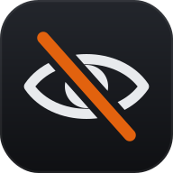
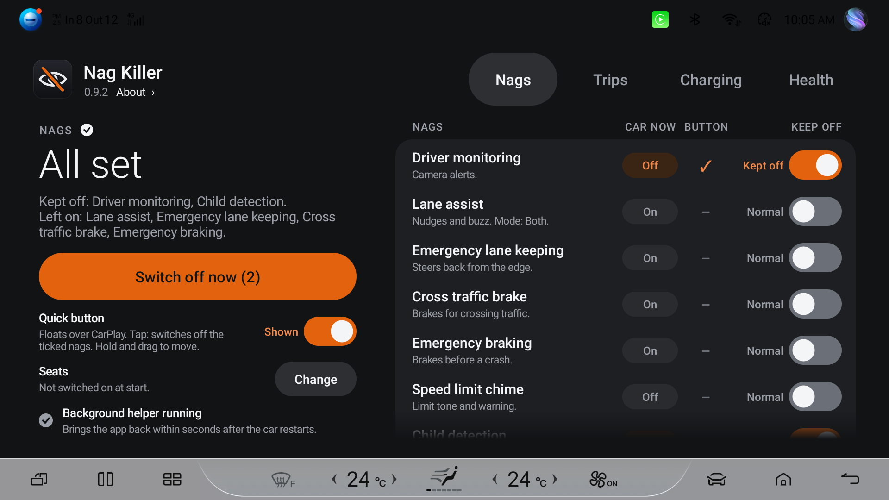
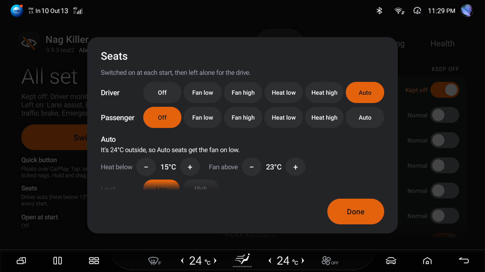
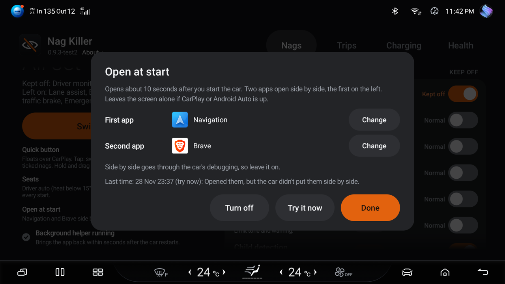
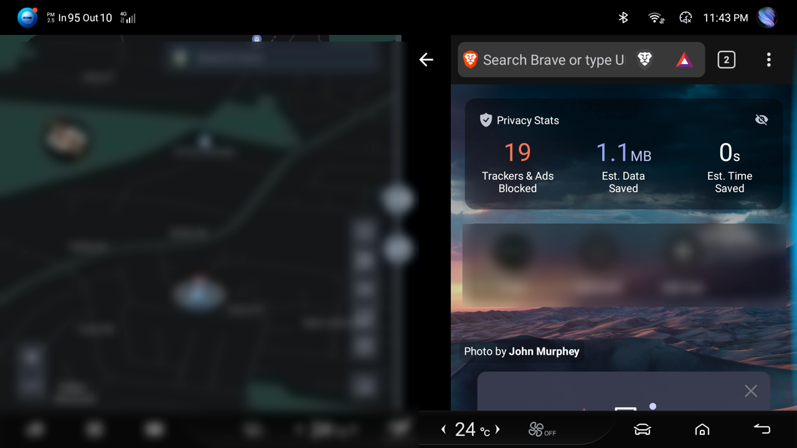
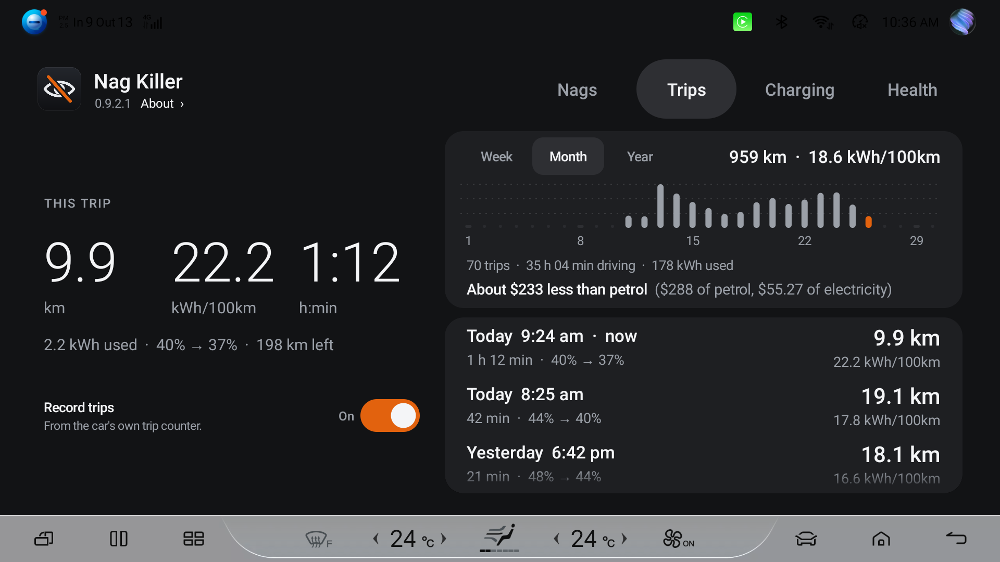
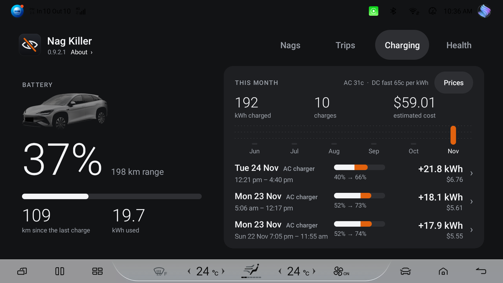
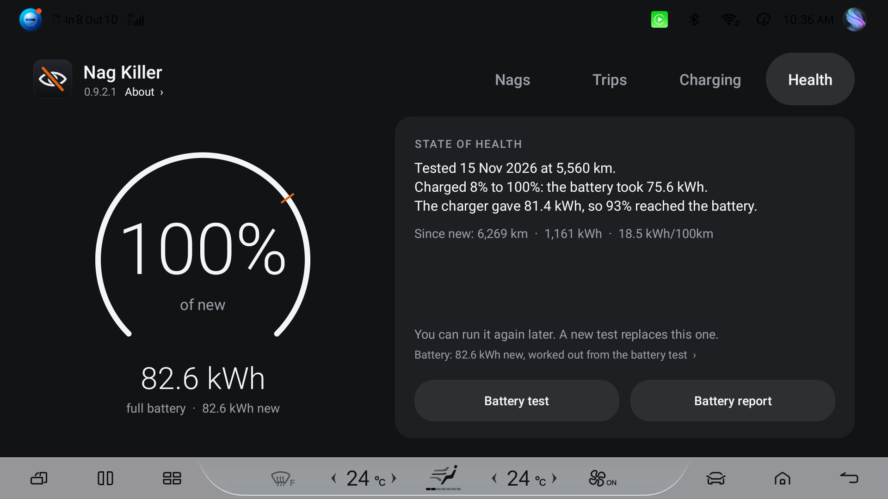

# Nag Killer for BYD Sealion 7

An Android app that runs on the car's screen and keeps the nags you don't want switched off,
every time you start the car. It can also put your seat fans or seat heat on for you at every
start (or pick by the outside temperature), open your apps when the car comes on, two side by
side if you like, move the driver's seat to a saved position in one tap, and it keeps a log of
your trips and charges and a battery health figure
([see below](#trips-charging-and-health)).

It can turn off:

* Driver monitoring (DMS), the fatigue and distraction alerts from the steering column camera
* Lane assist, the steering nudges and lane departure buzz
* The speed limit chime
* Child detection, the "child left in the car" alarm
* Emergency braking (AEB)
* Cross traffic brake (FCTB, "front lateral approach braking" in the car menu)
* Emergency lane keeping (ELKA)

The last four are safety systems. They're left alone unless you turn them on, the app asks you
to confirm, and they're not on the quick button unless you add them.

BYD turns these back on at every start. Nag Killer switches them off again a few seconds after
you start the car. It uses the same BYD settings services as the car's own Settings screen, so
Settings always shows the real state. No root, nothing on the system is modified, and nothing goes
online unless you tap Check for update.

There's also a floating button that sits over CarPlay and switches the nags you pick off again
in one tap.

Tested on an Australian 2025 Sealion 7 (DiLink 5, Android 11). European Sealion 7 owners have
confirmed it on theirs. Other models haven't been tried.

## Seats

No more pressing the seat buttons every drive. For the driver and the passenger seat pick Off,
Fan low, Fan high, Heat low, Heat high or Auto, and the app switches it on a few seconds after
each start. Auto goes by the outside temperature (the one the car shows): colder than your
"Heat below" temperature and it puts the seat heat on, warmer than "Fan above" and it puts the
fan on, in between it leaves the seat off. The Seats box says what Auto is doing right now ("It's 24°C
outside, so Auto seats get the fan on low"). After that it leaves the seat alone, so if you turn
it off mid-drive it stays off until the next start. Heat is new in 0.9.2, Auto in 0.9.3 (thanks
@m1ckyb).

The same box has Position 1 and Position 2 buttons that move the driver's seat to the positions
saved in the car's own seat screen. Handy when the last driver was a lot shorter than you: lean
in and tap, instead of climbing in to reach the car's menu. Hold a button to save where the seat
is now as that position. It only works in Park, and the app never moves the seat by itself. New
in 0.9.2.

## Open at start

Pick an app, or two, and they open by themselves about 10 seconds after you start the car. Two
apps open side by side in the car's own split screen, so you can have the map on one side and
music on the other without touching anything. It opens them the same way BYD's own split screen
does, so BYD's map works too, and an app that's already running gets moved into its half. If
CarPlay or Android Auto is already on the screen, the app leaves it alone. New in 0.9.3.

Not every app can go side by side. The app picker marks the ones the car won't split as "Full
screen only" (Amazon Music is one), using the same rule as BYD's split screen. Those still work
as a single app.

Side by side goes through the car's debugging connection, so leave debugging on in the car.
One app on its own opens without it.

## Trips, Charging and Health

The car keeps no history of its own, so the app keeps it for you: every drive, every charge
and what it cost, what you've saved against petrol, and an honest battery health figure you
can show a buyer when you sell the car. New in 0.9.0. The nags and seats work the same as
before.

Everything stays on the car. None of it is sent anywhere.

### Trips

Every drive: distance, time, energy used, kWh/100km and battery % at the start and end, with a
chart you can switch between week, month and year. It copies the car's own trip counter (the
one the dash shows when you turn the car off), so the numbers match the car. Stops under 10
minutes count as one trip. While you're driving it only shows the current trip and the range
left, in big figures; the history appears in Park.

If you enter a petrol price and what a petrol car would use, it shows what you've saved against
petrol. A copy of the log is saved as `trips.csv` in `/sdcard/Android/data/au.jaso.naglab/files/`.

### Charging

The battery percent and range, how far you've driven since the last charge, this month's
charging in three figures (kWh, number of charges, estimated cost), and a list of your charges
with before and after percent and the kWh that went into the battery. If you sit in the car
while it's plugged in you also get kW and the car's own time to full.

* The app tries to tell AC from DC fast charging by itself. You can change it on any charge.
* Enter what you pay per kWh for AC and for DC and each charge gets a cost. If a charge cost
  something different, type what you actually paid for that one.
* Costs are worked out from the kWh that reached the battery, so your real bill is a little
  higher (charging losses).

### Health

State of health from one battery test: what a full battery holds now against what it held
new, with BYD Australia's 70% warranty line marked. New is 82.56 kWh on most cars and 91.3 kWh
on the European Excellence AWD. The app works out which one you have from the test, and you
can pick it yourself on the Health tab. The tab also shows the car's own lifetime figures: km,
kWh used and kWh/100km since new.

* Battery test: start it when the battery is at 10% or less, charge to 100% on an AC charger
  without driving, and the app works out the figure from that one charge. The car can be off
  while it charges. It can't be started above 10%, it has to reach 100%, and it tells you if
  something spoiled it. Type in the kWh your charger showed and it also shows how much of it
  reached the battery. You can run it again later; the new result replaces the old one.
* Battery report: a one-page report with the car's VIN, odometer, the test result and what it
  rests on, and your charging and trip totals. With the car on Wi-Fi you can open it on your
  phone to save or print. While the report box is open, anyone on the same Wi-Fi can open it
  (it has your VIN on it); press Done and it stops. It says on it that it's an owner's log, not
  a certificate.

The figure comes from the car's own battery computer, so it is that computer's opinion, not an
independent test.

### What has and hasn't been tested

Tested on my car:

* Trips match the car's own trip summary.
* One AC charge on a 7 kW wallbox showed correctly while it was happening and afterwards.
* Prices, costs and the petrol saving show and add up.
* The report opens on a phone on the same Wi-Fi, and stops being served when its box closes.
* Check for update (in About) updated the car by itself, more than once.
* The Mac installer script ran start to finish.
* Seat fans come back after a restart, and stay off if you turn one off mid-drive.
* Seat heat (26 Nov 2026): Low, High and Off on both front seats from the app, and it comes
  back on after the app is restarted the way the car restarts it. Not yet seen over a real
  car off and on.
* Position 1 and Position 2 move the driver's seat to the saved positions, and a hold saves
  where the seat is now (26 Nov 2026).
* The battery test, once: 8% to 100% on a 7 kW wallbox took 75.6 kWh into the battery, a full
  battery of 82.6 kWh at 5,560 km. The charger showed 81.4 kWh, so 93% reached the battery.

Not tested yet:

* DC fast charging. The app has never seen one, so telling AC from DC is unproven.
* Whether the kWh figures match what a charger or a power bill says.
* The Windows installer script in the `install` folder (see Install below).
* Any car other than one Australian 2025 Sealion 7.

The battery figures are the car's own battery computer's sums. They're a good guide, not a
warranty assessment.

### Tell me what you think

I'd like to hear what's wrong, what's confusing and what you'd want it to do:
[open an issue](https://github.com/jasoisjaso/byd-nag-killer/issues). Numbers that don't match
your car, your charger or your bill are the most useful thing you can send.

## Install

You need a computer on the same Wi-Fi as the car for a couple of minutes. A USB stick or the
car's browser won't work, the car blocks installs from its own screen.

1. Download `naglab.apk` from [Releases](https://github.com/jasoisjaso/byd-nag-killer/releases/latest)
   and Google's [platform-tools](https://developer.android.com/tools/releases/platform-tools).
   Unzip platform-tools and put the APK in that folder.

2. Turn on debugging in the car, parked:

   * Go to Settings > System > Version. The last row has the words "Factory reset" in white on
     the left and a blue Reset button on the right.
   * **Don't touch the blue Reset button. It wipes the car.**
   * Tap the white words "Factory reset" 7 times, about 2 taps a second. Nothing shows until
     the 7th tap. If a "Reset?" box ever pops up, tap Cancel.
   * Rotate the screen to portrait. In landscape the debugging button is off the edge of the
     screen and you won't see it.
   * Tap the first long grey button, "CONNECT USB TO ENABLE DEBUGGING MODE". Leave the rest of
     that page alone. Rotate back.
   * Note the car's IP under Settings > Wi-Fi > your network (something like 192.168.1.50).

   The car turns debugging off again after it's been parked a while. You only need it on to
   install.

3. Open a terminal in the platform-tools folder and run these with your car's IP. On Windows
   start each line with `.\adb`, on Mac or Linux `./adb`.

       adb connect 192.168.1.50:5555
       adb install -r naglab.apk
       adb shell cmd notification allow_listener au.jaso.naglab/au.jaso.naglab.NagListener
       adb shell appops set au.jaso.naglab SYSTEM_ALERT_WINDOW allow

   When the car asks "Allow USB debugging?", tick Always allow and tap Allow. The last two
   lines let the app restart itself after the car shuts it down, and let the floating button
   show over other apps.

4. Open Nag Killer in the car. If the Background helper row says it's off or not running, tap
   Start and then Allow. Done, you don't need the computer again.

### Installer scripts (new)

The [install](install) folder has a script for Mac and one for Windows that do steps 1, 3 and 4
for you: they download adb and the latest release, find the car on your Wi-Fi, install the app
and set it up. You still turn debugging on in the car yourself (step 2). The Mac one has run
start to finish on my car. The Windows one hasn't been run at all yet, so if one stops, do it by
hand as above and tell me what it said in an issue.

* Mac: download `install-mac.command`, open Terminal, type `bash ` (with a space after it),
  drag the file onto the Terminal window and press Enter. Double-clicking a downloaded copy
  doesn't work, macOS blocks it.
* Windows: download `install-windows.bat` and `install-windows.ps1` into the same folder and
  double-click the `.bat`. If Windows says it protected your PC, click More info, then Run
  anyway.

## Using it

Each nag has a row with two things: what the car currently reports, and a Keep off switch.
Tap anywhere on the row to flip the switch. The word next to it says which way it's set.

* Kept off: the nag goes off now and stays off at every start. The app remembers how it
  was set first (for example which lane assist mode you had).
* Normal: the nag goes back to how it was.

If a nag you keep off gives no reading at all (your car may not have it), the headline says
"Can't read" and names it.

The big "Switch off now" button on the left switches off the nags ticked in the Button column,
straight away. Tap the tick to add or remove a nag. That pick is separate from Keep off, so the
button can be a one-tap fix for something you only sometimes want gone. The number on it is how
many nags it covers. It only ever turns things off, so tapping it again by accident while
driving won't bring anything back. If nothing is ticked, the button is greyed out.

Turn on "Quick button" (under the big button) and the same button floats over everything,
CarPlay included. Tap it and a card says "Switching off", then what the car reported: All off,
Still on, or No answer. Hold it, then drag to move it. A small amber "!" shows on it when one
of its nags is on.

Seats: tap Change on the Seats row and pick Off, Fan low, Fan high, Heat low, Heat high or Auto for
each seat. Picking one switches that seat now, and the app switches it on again every time you
start the car. In Auto mode you can set the "Heat below" and "Fan above" outside temperatures and
choose Low or High; between the two temperatures the seat stays off. After that it leaves the seats
alone for the drive, so if you turn one off it stays off until the next start. Off means the app
never touches that seat. A seat runs its fan or its heater, not both: that's the car, not the app.

Under those, Position 1 and Position 2 move the driver's seat to the positions saved in the
car. Hold one and the app asks, then saves where the seat is now as that position (it replaces
what was saved, the same as holding the button on the car's own seat screen). Park only.

Open at start: tap Change on the Open at start row, pick the app for the left and, if you want
two, the one for the right, then tap Try it now. The first time, the car asks "Allow USB
debugging?" for Nag Killer itself: tick Always allow and tap Allow, otherwise it can't open them
by itself at start. Turn off in the same box.

If the app can't reach either of BYD's settings services for 20 seconds, the headline says
"Can't reach the car". Tap "About & car report" under the name at the top left for the version and a car report.

## How it stays running

BYD force-stops third party apps when the car turns off, and the screen sometimes reboots
overnight. Two things bring the app back:

* Notification access. Android restarts the app by itself after it's killed or after a reboot.
  The app doesn't read your notifications, this is just the hook.
* A small background script (`watchdog.sh`) that restarts the app within a few seconds. If it's
  gone after a reboot, the app starts it again over the car's own debugging connection.

It doesn't touch Overdrive. If you use Overdrive, the script also wakes it when the car starts.

## What's been tested

On my car: DMS, lane assist, child detection, the speed chime, AEB, cross traffic brake and
emergency lane keeping all go off and come back properly, they're switched off again after a
restart, the app comes back after the car turns off and after the screen reboots, and it
survives a night parked. Seat fans come back on at Low or High after a restart. Seat heat
switches from the app, and the seat position buttons move the seat and save a position.
Open at start with two apps side by side has been confirmed by an owner in Austria over several
real starts, and on my car with BYD's map and Brave. Auto seats were tested by @m1ckyb on his Sealion 7. Trips, Charging and Health have
their own list above. The over-limit warning switch hasn't been confirmed yet because it
was already off on my car.

## Other BYDs

Tested on the AU Sealion 7, and EU owners have confirmed the European one. BYD numbers its
commands differently on different firmware (that's what broke child detection on EU cars), so
the app reads the right numbers off the car itself, from BYD's own library. Other DiLink 5 cars
might work. DiLink 3 cars (Atto 3, Dolphin, older Seal) won't work.

If something doesn't switch, tap "About & car report" under the name, then Car report. It only
reads. Post a photo of it, or the file (`adb pull
/sdcard/Android/data/au.jaso.naglab/files/car-report.txt`), in an issue.

If you want to check a car without installing anything:

    adb shell pm path com.ts.appservice.settings
    adb shell pm path com.ts.appservice.caradapter

If both print a path it's worth a try. Open an issue and say how it went.

## Troubleshooting

* No debugging button after the 7 taps. Rotate the screen to portrait. If nothing opened at all,
  tap the white words again slowly and evenly.
* `adb connect` fails. The car has turned debugging off again. Redo step 2. If it still fails,
  run `adb kill-server` and try again.
* The Background helper row says off or not running, and Start fails. Download `naglab_watchdog.sh` from the
  release into the platform-tools folder and run:

      adb push naglab_watchdog.sh /data/local/tmp/naglab_watchdog.sh
      adb shell "chmod 755 /data/local/tmp/naglab_watchdog.sh; setsid nohup /data/local/tmp/naglab_watchdog.sh >/dev/null 2>&1 </dev/null &"

  DMS still stays off without it, the helper just brings the app back faster.
* The floating button doesn't show. Run the `appops` line from step 3.
* The app doesn't come back after the car's been off. Run the `allow_listener` line from step 3
  and open the app once.
* A nag shows "still on". The car didn't take the change. Try the switch again. Logs:
  `adb logcat -s NagLab:W`

## Update or remove

* Update: `adb install -r naglab.apk`. Settings are kept. From 0.9.0 the app can also update
  itself from the car's screen: turn debugging on, then About > Check for update. That's the
  only time the app goes online.
* Stop the helper: `adb shell touch /data/local/tmp/naglab_watchdog.disabled`
* Remove: turn the Keep off switches off, then `adb uninstall au.jaso.naglab`

## Roadmap

No dates. Want something on here, or moved up? Thumbs-up or open an issue. To hear when things
ship: Watch > Custom > Releases.

Being worked on:

* Range worked out from your own driving, and distance since the last full charge.
* Leave lock. The car locks itself once you've turned it off, got out and shut every door.
  Locking from the app works on my car, the hard part is making sure nobody's still inside.
  On my car only until it's proven.

Next:

* Rear cross traffic brake off, same idea as the front one.
* Seatbelt chime off for a bag or a dog on the passenger seat.

Maybe. BYD's software has a switch for these, but I haven't tried them on a car yet, and some
may not be fitted to the Sealion 7:

* Heated steering wheel on at every start, like the seats (my car doesn't have one).
* Regen level remembered between drives.
* Pet, camp and rest mode from the app.
* Cruise control voice prompts off.
* Pedestrian warning sound (the "ice-cream van" noise). It's a legal requirement in some
  countries, so this one depends on where you are.
* Engine sound type remembered.
* Climate start preset, so it doesn't come on at fan 7.
* Auto wipers remembered.

Not doing: unlocking hidden features or coding the car, anything that needs root or changes
the system, and the HUD or cluster layout.

## Building it yourself

Needs a Mac or Linux machine with JDK 17+ and adb. No Gradle.

    tools/get-tools.sh            # once, downloads build-tools and android-30.jar from Google
    app/install.sh 192.168.1.50   # build, install, grant permissions, start the helper
    app/test/run.sh               # tests
    tools/get-screen-tools.sh     # once, for the screen check below (about 330 MB, needs a JDK 17 to 21 to run)
    app/test/screens.sh           # draws the Trips tab at the car's screen size and checks nothing is cut off or run together

The first build creates `app/keys/naglab.keystore`. Your own build can't install over the
release APK (different key), so uninstall first.

### How it talks to the car

DMS: bind `com.ts.appservice.settings/.SettingsService` (action
`com.ts.lib.settings.ISettingsAdapterService`), transact 2 with `"dms"` to get
`com.ts.lib.settings.dms.IDmsSettingsService`. Codes: 2 set DMS, 4 set fatigue, 5 set attention,
6/7/8 read them, 11/12 subscribe/unsubscribe. 0 is off, 1 is on. All three are set because
turning only the master off leaves the other two on.

Lane assist, chime and child detection: bind `com.ts.appservice.caradapter/.CarAdapterService`
(action `com.ts.lib.caradapter.ICarAdapterService`), transact 2 with `"assist"`. Read and write
codes are different:

| | Read | Write |
|---|---|---|
| Lane assist | 11: 0 off, 1 warning, 2 prevent, 3 both | 12: 1 off, 2 warning, 5 prevent, 4 both |
| Speed limit tone | 64: 0 on, 1 off | 65: 2 on, 1 off |
| Over-limit warning | 71 / 72: 1 on | 22: 2 on, 1 off |
| Child detection | 187: 1 standard, 3 delay, 2 off | 185: same |
| Emergency braking | 46: 1 on, 0 off | 47: 2 on, 1 off |
| Cross traffic brake | 53: 1 on, 0 off | 54: 2 on, 1 off |
| Emergency lane keeping | 79 (or 80 on some cars): 1 on, 0 off | 35: 2 on, 1 off |

Seat fans: same `CarAdapterService`, transact 2 with `"setting"` to get
`com.ts.lib.caradapter.setting.ISettingService`.

| | Read | Write |
|---|---|---|
| Driver seat fan | 354: 1 off, 2 low, 3 high | 358: 1 high, 2 low, 3 off |
| Passenger seat fan | 462: same | 359: same |
| Driver seat heat | 346: 1 off, 2 low, 3 high | 350: 1 high, 2 low, 3 off |
| Passenger seat heat | 459: same | 351: same |
| Driver seat to a saved position | | 173 `resetSeatParamsDriver`: 1 or 2 |
| Save the driver seat's position | | 254 `saveSeatParamsAllDriver`: 1 or 2 |

Temperature (for Auto seat mode): `"hvac"` sub-binder (`IHvacAdapterService`), 18
`getTempratureOut` (int, °C; `getTemperatureSensorValue` on `"sensor"` stays 0 on the Sealion 7).

Yes, write is the reverse of read. 355 and 347 look like the passenger getters but read 0 on the
AU car, the climate app uses 462 and 459. Switching a seat's heat on switches its fan off, and
the other way round.

173 is called "reset" but it's the recall: it's what the Position buttons on the car's own seat
screen send on a tap, and a hold sends 254. Both work from the app on my car. Neither call
answers with a result, so there's nothing to read back.

The write calls don't say whether the car accepted the change, so the app reads it back.

All the numbers above are from the AU firmware. BYD moves them around between firmware
versions, so for everything on `CarAdapterService` the app looks each one up by method name in
the car's `/system/framework/ts-framework.jar` and only falls back to these if it can't. The
DMS numbers are used as they are.

## Disclaimer

Use at your own risk. Driver monitoring, child detection, AEB, cross traffic brake and emergency
lane keeping are safety features. The last three brake or steer to avoid a crash. This is for
people who've decided they don't want them and are sick of the car ignoring that. You're
still the driver.

MIT licence.
