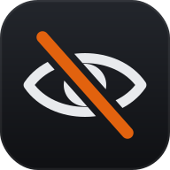
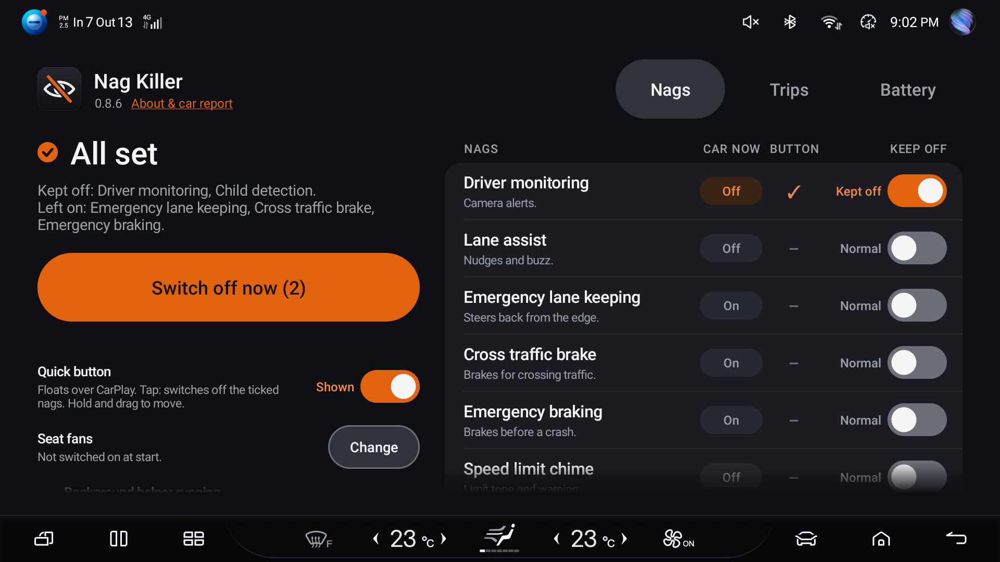
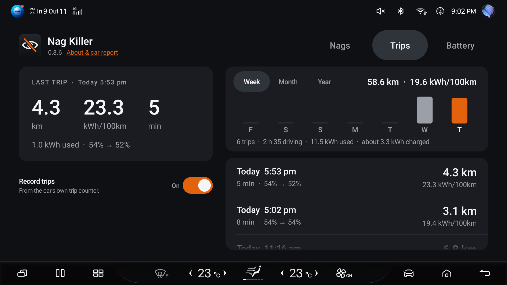
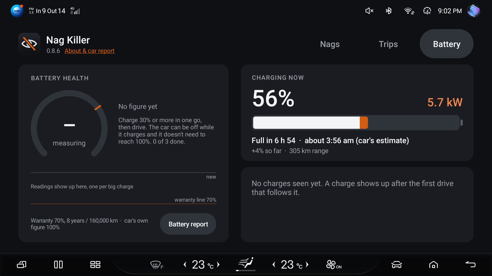

# Nag Killer for BYD Sealion 7

An Android app that runs on the car's screen and keeps the nags you don't want switched off,
every time you start the car. It can also put your seat fans on for you at every start, and it
keeps a log of your trips and charges.

It can turn off:

* Driver monitoring (DMS), the fatigue and distraction alerts from the steering column camera
* Lane assist, the steering nudges and lane departure buzz
* The speed limit chime
* Child detection, the "child left in the car" alarm
* Emergency braking (AEB)
* Cross traffic brake (FCTB, "front lateral approach braking" in the car menu)
* Emergency lane keeping (ELKA)

The last four are safety systems. They're left alone unless you turn them on, the app asks you
to confirm, and they're not on the quick button unless you add them.

BYD turns these back on at every start. Nag Killer switches them off again a few seconds after
you start the car. It uses the same BYD settings services as the car's own Settings screen, so
Settings always shows the real state. No root, nothing on the system is modified, nothing goes
online.

There's also a floating button that sits over CarPlay and switches the nags you pick off again
in one tap.

Tested on an Australian 2025 Sealion 7 (DiLink 5, Android 11). European Sealion 7 owners have
confirmed it on theirs. Other models haven't been tried.

## Seat fans

No more pressing the seat fan buttons every drive. Pick Off, Low or High for the driver and
passenger seats and the app switches them on a few seconds after each start. After that it
leaves them alone, so if you turn one off mid-drive it stays off until the next start.

## Trips

A Trips tab with every drive: distance, time, energy used, kWh/100km and battery % at the start
and end, plus a bar chart you can switch between week, month and year, with totals for each
(trips, driving time, kWh used, kWh charged). It copies the car's own trip counter (the one the dash
shows when you turn the car off), so the numbers match the car. Stops under 10 minutes are shown
as one trip. While you're driving it only shows the current trip; the history appears when you're
in Park.

It reads the car a few times a minute and saves to a small file on the car. Nothing goes online.
You can switch it off on the Trips tab.

A charge shows as its own line between the two trips either side of it. After each trip a copy
of the log is saved as `trips.csv` in `/sdcard/Android/data/au.jaso.naglab/files/` so you can
pull it off the car and open it in a spreadsheet.

## Battery

A Battery tab with your charges and, over time, how healthy the battery is.

The app isn't running while the car is off, so it doesn't watch a charge happen. It reads the
battery (percent and kWh) at the end of one drive and again at the start of the next, and the
difference is the charge. That means the car can be off while it charges, any charger works,
and it doesn't need to go to 100%.

* Charges: every charge with before and after percent and the kWh that went into the battery
  (not what the charger billed you, charging losses aren't in it), and kWh per month.
* Charging now: if you sit in the car while it's plugged in you get percent, kW and the car's
  own time-to-full.
* Battery health: what a full battery holds now against the 82.56 kWh it held new, with a mark
  at BYD Australia's 70% warranty line. It takes one reading from each charge or drive that
  moves the battery 30% or more in one go, shows a figure after three, and uses the middle of
  the last ten so one odd charge doesn't move it.

The Battery report button saves a one-page `battery-report.html` in
`/sdcard/Android/data/au.jaso.naglab/files/` with the car's VIN, the date and odometer, the health
figure and every reading behind it, and your charging and trip totals. It says on it that it's
an owner's log, not a certificate.

The health figure is new and I'm still checking it on my own car. It's worked out from the
car's own battery computer, so it's that computer's opinion, not an independent test. Don't
rely on it for a sale yet.

## Install

You need a computer on the same Wi-Fi as the car for a couple of minutes. A USB stick or the
car's browser won't work, the car blocks installs from its own screen.

1. Download `naglab.apk` from [Releases](https://github.com/jasoisjaso/byd-nag-killer/releases/latest)
   and Google's [platform-tools](https://developer.android.com/tools/releases/platform-tools).
   Unzip platform-tools and put the APK in that folder.

2. Turn on debugging in the car, parked:

   * Go to Settings > System > Version. The last row has the words "Factory reset" in white on
     the left and a blue Reset button on the right.
   * **Don't touch the blue Reset button. It wipes the car.**
   * Tap the white words "Factory reset" 7 times, about 2 taps a second. Nothing shows until
     the 7th tap. If a "Reset?" box ever pops up, tap Cancel.
   * Rotate the screen to portrait. In landscape the debugging button is off the edge of the
     screen and you won't see it.
   * Tap the first long grey button, "CONNECT USB TO ENABLE DEBUGGING MODE". Leave the rest of
     that page alone. Rotate back.
   * Note the car's IP under Settings > Wi-Fi > your network (something like 192.168.1.50).

   The car turns debugging off again after it's been parked a while. You only need it on to
   install.

3. Open a terminal in the platform-tools folder and run these with your car's IP. On Windows
   start each line with `.\adb`, on Mac or Linux `./adb`.

       adb connect 192.168.1.50:5555
       adb install -r naglab.apk
       adb shell cmd notification allow_listener au.jaso.naglab/au.jaso.naglab.NagListener
       adb shell appops set au.jaso.naglab SYSTEM_ALERT_WINDOW allow

   When the car asks "Allow USB debugging?", tick Always allow and tap Allow. The last two
   lines let the app restart itself after the car shuts it down, and let the floating button
   show over other apps.

4. Open Nag Killer in the car. If the Background helper row says it's off or not running, tap
   Start and then Allow. Done, you don't need the computer again.

## Using it

Each nag has a row with two things: what the car currently reports, and a Keep off switch.
Tap anywhere on the row to flip the switch. The word next to it says which way it's set.

* Kept off: the nag goes off now and stays off at every start. The app remembers how it
  was set first (for example which lane assist mode you had).
* Normal: the nag goes back to how it was.

If a nag you keep off gives no reading at all (your car may not have it), the headline says
"Can't read" and names it.

The big "Switch off now" button on the left switches off the nags ticked in the Button column,
straight away. Tap the tick to add or remove a nag. That pick is separate from Keep off, so the
button can be a one-tap fix for something you only sometimes want gone. The number on it is how
many nags it covers. It only ever turns things off, so tapping it again by accident while
driving won't bring anything back. If nothing is ticked, the button is greyed out.

Turn on "Quick button" (under the big button) and the same button floats over everything,
CarPlay included. Tap it and a card says "Switching off", then what the car reported: All off,
Still on, or No answer. Hold it, then drag to move it. A small amber "!" shows on it when one
of its nags is on.

Seat fans: tap Change on the Seat fans row and pick Off, Low or High for each seat. Picking one
switches that seat now, and the app switches it on again every time you start the car. After
that it leaves the seats alone for the drive, so if you turn one off it stays off until the next
start. Off means the app never touches that seat.

If the app can't reach either of BYD's settings services for 20 seconds, the headline says
"Can't reach the car". Tap "About & car report" under the name at the top left for the version and a car report.

## How it stays running

BYD force-stops third party apps when the car turns off, and the screen sometimes reboots
overnight. Two things bring the app back:

* Notification access. Android restarts the app by itself after it's killed or after a reboot.
  The app doesn't read your notifications, this is just the hook.
* A small background script (`watchdog.sh`) that restarts the app within a few seconds. If it's
  gone after a reboot, the app starts it again over the car's own debugging connection.

It doesn't touch Overdrive. If you use Overdrive, the script also wakes it when the car starts.

## What's been tested

On my car: DMS, lane assist, child detection, the speed chime, AEB, cross traffic brake and
emergency lane keeping all go off and come back properly, they're switched off again after a
restart, the app comes back after the car turns off and after the screen reboots, and it
survives a night parked. Seat fans come back on at Low or High after a restart. Trips match the car's own trip summary. The Battery tab shows a live charge correctly; the health figure hasn't been checked yet. The over-limit warning switch hasn't been confirmed yet because it
was already off on my car.

## Other BYDs

Tested on the AU Sealion 7, and EU owners have confirmed the European one. BYD numbers its
commands differently on different firmware (that's what broke child detection on EU cars), so
the app reads the right numbers off the car itself, from BYD's own library. Other DiLink 5 cars
might work. DiLink 3 cars (Atto 3, Dolphin, older Seal) won't work.

If something doesn't switch, tap "About & car report" under the name, then Car report. It only
reads. Post a photo of it, or the file (`adb pull
/sdcard/Android/data/au.jaso.naglab/files/car-report.txt`), in an issue.

If you want to check a car without installing anything:

    adb shell pm path com.ts.appservice.settings
    adb shell pm path com.ts.appservice.caradapter

If both print a path it's worth a try. Open an issue and say how it went.

## Troubleshooting

* No debugging button after the 7 taps. Rotate the screen to portrait. If nothing opened at all,
  tap the white words again slowly and evenly.
* `adb connect` fails. The car has turned debugging off again. Redo step 2. If it still fails,
  run `adb kill-server` and try again.
* The Background helper row says off or not running, and Start fails. Download `naglab_watchdog.sh` from the
  release into the platform-tools folder and run:

      adb push naglab_watchdog.sh /data/local/tmp/naglab_watchdog.sh
      adb shell "chmod 755 /data/local/tmp/naglab_watchdog.sh; setsid nohup /data/local/tmp/naglab_watchdog.sh >/dev/null 2>&1 </dev/null &"

  DMS still stays off without it, the helper just brings the app back faster.
* The floating button doesn't show. Run the `appops` line from step 3.
* The app doesn't come back after the car's been off. Run the `allow_listener` line from step 3
  and open the app once.
* A nag shows "still on". The car didn't take the change. Try the switch again. Logs:
  `adb logcat -s NagLab:W`

## Update or remove

* Update: `adb install -r naglab.apk`. Settings are kept.
* Stop the helper: `adb shell touch /data/local/tmp/naglab_watchdog.disabled`
* Remove: turn the Keep off switches off, then `adb uninstall au.jaso.naglab`

## Roadmap

No dates. Want something on here, or moved up? Thumbs-up or open an issue. To hear when things
ship: Watch > Custom > Releases.

Being worked on:

* Leave lock. The car locks itself once you've turned it off, got out and shut every door.
  Locking from the app works on my car, the hard part is making sure nobody's still inside.
  On my car only until it's proven.

Next:

* Rear cross traffic brake off, same idea as the front one.
* Seatbelt chime off for a bag or a dog on the passenger seat.

Maybe. BYD's software has a switch for these, but I haven't tried them on a car yet, and some
may not be fitted to the Sealion 7:

* Heated steering wheel and seat heating on at every start, like the seat fans.
* Regen level remembered between drives.
* Pet, camp and rest mode from the app.
* Cruise control voice prompts off.
* Pedestrian warning sound (the "ice-cream van" noise). It's a legal requirement in some
  countries, so this one depends on where you are.
* Engine sound type remembered.
* Climate start preset, so it doesn't come on at fan 7.
* Auto wipers remembered.

Not doing: unlocking hidden features or coding the car, anything that needs root or changes
the system, and the HUD or cluster layout.

## Building it yourself

Needs a Mac or Linux machine with JDK 17+ and adb. No Gradle.

    tools/get-tools.sh            # once, downloads build-tools and android-30.jar from Google
    app/install.sh 192.168.1.50   # build, install, grant permissions, start the helper
    app/test/run.sh               # tests

The first build creates `app/keys/naglab.keystore`. Your own build can't install over the
release APK (different key), so uninstall first.

### How it talks to the car

DMS: bind `com.ts.appservice.settings/.SettingsService` (action
`com.ts.lib.settings.ISettingsAdapterService`), transact 2 with `"dms"` to get
`com.ts.lib.settings.dms.IDmsSettingsService`. Codes: 2 set DMS, 4 set fatigue, 5 set attention,
6/7/8 read them, 11/12 subscribe/unsubscribe. 0 is off, 1 is on. All three are set because
turning only the master off leaves the other two on.

Lane assist, chime and child detection: bind `com.ts.appservice.caradapter/.CarAdapterService`
(action `com.ts.lib.caradapter.ICarAdapterService`), transact 2 with `"assist"`. Read and write
codes are different:

| | Read | Write |
|---|---|---|
| Lane assist | 11: 0 off, 1 warning, 2 prevent, 3 both | 12: 1 off, 2 warning, 5 prevent, 4 both |
| Speed limit tone | 64: 0 on, 1 off | 65: 2 on, 1 off |
| Over-limit warning | 71 / 72: 1 on | 22: 2 on, 1 off |
| Child detection | 187: 1 standard, 3 delay, 2 off | 185: same |
| Emergency braking | 46: 1 on, 0 off | 47: 2 on, 1 off |
| Cross traffic brake | 53: 1 on, 0 off | 54: 2 on, 1 off |
| Emergency lane keeping | 79 (or 80 on some cars): 1 on, 0 off | 35: 2 on, 1 off |

Seat fans: same `CarAdapterService`, transact 2 with `"setting"` to get
`com.ts.lib.caradapter.setting.ISettingService`.

| | Read | Write |
|---|---|---|
| Driver seat fan | 354: 1 off, 2 low, 3 high | 358: 1 high, 2 low, 3 off |
| Passenger seat fan | 462: same | 359: same |

Yes, write is the reverse of read. 355 looks like the passenger getter but reads 0 on the AU
car, the climate app uses 462.

The write calls don't say whether the car accepted the change, so the app reads it back.

All the numbers above are from the AU firmware. BYD moves them around between firmware
versions, so the app looks each one up by method name in the car's
`/system/framework/ts-framework.jar` and only falls back to these if it can't.

## Disclaimer

Use at your own risk. Driver monitoring, child detection, AEB, cross traffic brake and emergency
lane keeping are safety features. The last three brake or steer to avoid a crash. This is for
people who've decided they don't want them and are sick of the car ignoring that. You're
still the driver.

MIT licence.
